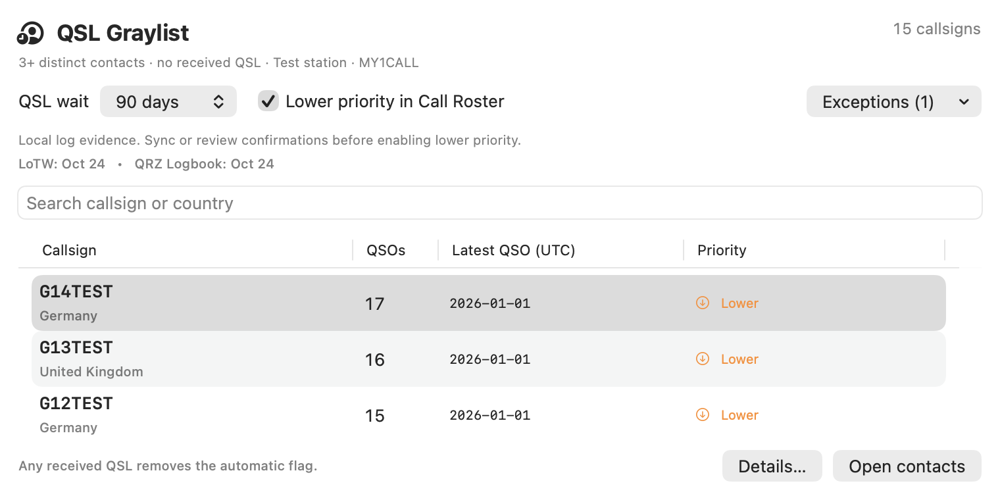
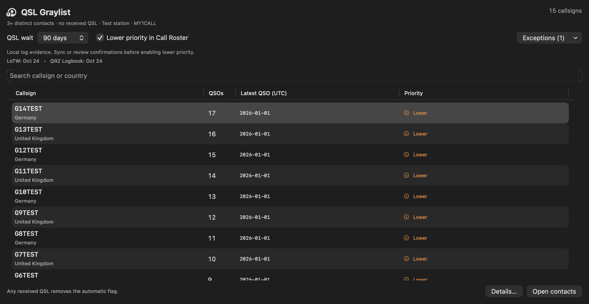

# QSL Graylist · Y-163 / #421

Date: 2026-10-24 (Asia/Tehran). Tracking: [shared board #421](https://github.com/fact0real/yaam-lab599-shared-board/issues/421).

Delivery version: **YAAM 1.37.46 (196)**. The feature and release package are prepared from an isolated checkout based on 1.37.45; concurrent radio/serial changes in the original workspace are excluded. The source push, final Release build and installation checks are recorded in the delivery receipt and shared-board update. Local installation uses the existing entitlements and ad-hoc signing; no public binary release or updater-feed change is part of this delivery.

## Behavior

Open **Operator Desk → QSL & Data → QSL Graylist**, also available through the catalog-driven Tools menu and tool finder. The new destination uses legacy section 31; existing destination identifiers and routes retain their meanings.

- Aggregate the active profile's loaded database master workspace, independently of log-table filters. External-file and incompletely loaded/profile-mismatched workspaces clear the derived index and priority set.
- Normalize exact callsigns by whitespace/case, preserving portable/prefix/suffix distinctions. Explicit foreign profile IDs are excluded. Legacy rows inherit the loaded workspace's profile scope.
- Count distinct contacts using `QSOIdentity.exactKey`; imported copies do not inflate the count. Unidentifiable records do not satisfy the threshold. Any recognized received confirmation across the callsign's full history, including an otherwise incomplete record, disproves zero confirmations. The adapter uses the existing `QSORecordModel` received/sent semantics.
- Include callsigns with at least three distinct contacts and zero confirmations. Show callsign/country, count, latest UTC date and priority state. Details includes bands/modes, date range, recorded sent/submission evidence, incomplete identities/dates and a per-callsign priority exception. Open contacts uses the normal exact-callsign search and selects the relevant records; stale entries cannot open another workspace's records.
- Use a configurable QSL wait, default 90 days, with No wait / 30 / 60 / 90 / 180 / 365 presets. At least three contacts must be older than the wait before priority reduction. Newer contacts do not restart the older contacts' wait. Invalid/impossible dates and future contacts never satisfy the wait.
- **Lower priority in Call Roster** is initially off; the operator enables it after reviewing local history. Display profile-scoped LoTW/QRZ checkpoints, incomplete/stale history and app-wide failed/warning sync status with that scope explicitly named. Absence of a downloaded confirmation is local evidence, not a claim that another operator refused a QSL.
- When enabled, qualifying callsigns occupy a lower sort tier in the real Digital Call Roster and its Apex suggestion, with a visible reason. Existing entries and Apex update immediately when settings/evidence change. Direct calls to the operator remain first, and the original country/band/grid opportunity labels remain visible. Selection and logging stay available.
- Save the wait, enablement and exceptions per profile. Recompute after log/import/edit/delete/reconciliation or profile/load changes, using the existing debounced `LatestSnapshotWorker` on a detached utility task. Invalidate old penalties immediately; cancelled/outdated results cannot replace newer evidence. A minute timer refreshes age-based eligibility.
- Graylist evidence badges in the log callsign inspector and Quick Log intelligence open the workspace. English/Persian manuals and in-app confirmation help describe the feature and its limits.

## Verification

`python3 Tests/run-qsl-graylist-regressions.py` passes. The harness compiles the production aggregator, snapshot worker, store, AppState graylist adapter, search engine and Digital Call Roster against inert radio/audio/geography fixtures. The received/sent methods are extracted from the actual `QSORecordModel` source rather than reimplemented in the test fixture.

Coverage: 2/3-contact boundary, repeated imports, minute/second identity normalization, exact portable callsigns, every recognized received-confirmation field/value, sent/requested-only evidence, incomplete confirmed rows, explicit foreign-profile exclusion, precise UTC wait boundary, three old plus one recent contact, invalid/missing/future dates, deletion, cancellation/profile-switch races, per-profile preference/exception persistence, actual roster/Apex ordering, direct calls, immediate withdrawal of stale penalties, exact contact navigation and refusal of external/failed-load workspaces. The navigation regression also passes for all 36 destinations and persisted legacy routes.

A 30,000-distinct-contact, single-callsign aggregation completed in approximately **0.35 seconds** in the unoptimized local harness. This is an observed fixture result, not a performance guarantee for every log or Mac.

The actual SwiftUI content was rendered in isolated native windows at 760×380 and 1200×620 (compact content reserves space for the main window's navigation), in light/dark appearance. Loading, populated/selected, empty, incomplete/error-history, unavailable-workspace, details and evidence-badge states were inspected; native table selection enabled Details/Open contacts. The details background was corrected during visual review. System hover appearance and the integrated live-account app session were not separately inspected.

Reproduce the native snapshots with:

```sh
python3 Tests/run-qsl-graylist-regressions.py /tmp/yaam-qsl-graylist-visual
```

The `YAAM` scheme Debug build passes with signing disabled using the project's normal `build/DerivedData` directory. `git diff --check` also passes. No production log, credential, radio, or online confirmation service was used by the regression/visual harness.




