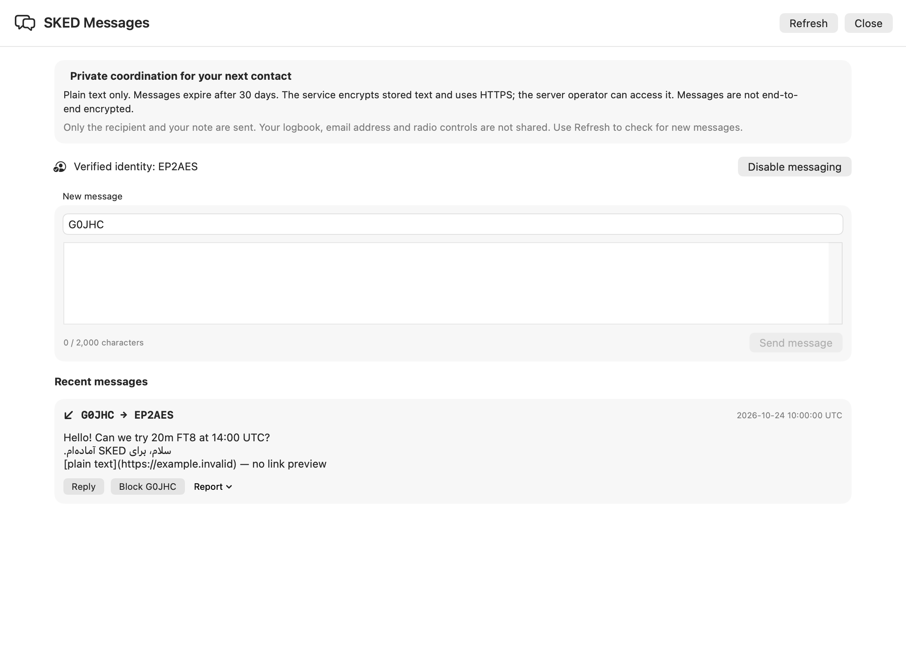

# SKED Private Messaging in YAAM

Shared Board: [Y-164 / #422](https://github.com/fact0real/yaam-lab599-shared-board/issues/422). Date: October 24, 2026, Tehran Timezone

## Evaluation & Outcome

This capability provides substantial value for coordinating contact time, band, and mode, especially when an operator lacks a public email address.

## Workflow

In the SKED view, **Messages** opens the inbox. The message icon next to an operator prepares the recipient.

If a transmission response drops, the same request ID is preserved for retries. A successful response signifies acceptance on the server, not delivery confirmation to the peer.

## Security Architecture Decisions

- Server activation is disabled by default. Membership is opt-in, and account identities are verified independently. Display names use callsigns only.
- Requests require dedicated bearer tokens over HTTPS. Browser cookies and session tokens do not grant messaging access. Clients enforce strict certificate and origin pinning.
- Message access is scoped strictly to sender and recipient accounts; only the recipient can submit an abuse report. Server storage uses separate user tables.
- Message text is encrypted using AES-256-GCM with random nonces; authenticated additional data (AAD) binds participant IDs and request metadata to ciphertext.
- Durable multiprocess rate limiting: 60 authenticated requests/min, 10 new dispatches/min, and 100 dispatches/day per account.
- Strict database transactions and ordered account locking prevent race conditions across sending, blocking, and consent toggles. Replayed requests return cached idempotency results.
- Plain text only is rendered: HTML, executable Markdown, link previews, and attachments are prohibited. Control characters and dangerous Unicode format characters are stripped.
- Messages expire after 30 days; an independent cron worker hourly purges expired ciphertext, reports, and legacy rate counters.

These controls align with the [OWASP Access Control Cheat Sheet](https://cheatsheetseries.owasp.org/cheatsheets/Authorization_Cheat_Sheet.html).

## Files Involved

YAAM: `SKEDMessagingService.swift`, `SKEDMessagingModel.swift`, and `SKEDMessagingView.swift` under `YAAM/`.

Local server source is located in `/Users/factoreal/Downloads/rank_qrz/results/qrz-project`. New files: `services/messaging.py`, `models/message.py`, `routes/messaging.py`.

## Review Evidence

| Verification | Result & Scope |
|---|---|
| Server tests on isolated database | 12 tests passed against live MySQL 26.10 with InnoDB and local socket. |
| Malicious & concurrency scenarios | Unrelated inbox isolation, unauthorized reporting, sender spoofing, oversized/control input rejection, revoked token handling, and idempotent replays verified. |
| Unicode response boundaries | Full page of 50 messages with 2,000 emojis per message remained well below client payload ceiling. |
| Server API general security | All 5 existing `test_api_security.py` suites passed; new endpoints verified under bearer token authentication. |
| Client test suite | Passed: origin-pinned requests, malicious input filtering, bulk response decoding, unrelated inbox rejection, quota limit error handling, and offline queue preservation. |
| Native UI review | 24 synthetic fixture screenshots across six states (loading, unavailable, unverified, disabled, inbox, retry) in light and dark modes. |
| Build verification | Debug build via `xcodebuild` with scheme `YAAM` succeeded cleanly; actor isolation warnings addressed. |

Swift test reproduction commands are documented at the top of test files, and server commands in `MESSAGING.md`.

## Pre-requisites for Live Production Deployment

Complete operational guide in server [MESSAGING.md](/Users/factoreal/Downloads/rank_qrz/results/qrz-project/MESSAGING.md).

Board status: **Review / Test** for local implementation; public deployment and server enablement pending operator review.

## Final Delivery & Owner Sign-Off

- Messaging service enabled on the existing qrz-rank host. Web views and cleanup workers confirmed healthy; rank and sync services unaffected.
- Live domain verified with temporary account over HTTPS, verifying identity mandates, token enforcement, direct HTTP rejection, and TLS configuration.
- Messaging database permissions are strictly scoped: no DDL privileges to create tables or modify core user accounts. Secrets stored in secure environment vaults.
- Nginx request size limits, timeouts, and rate limits configured for message endpoints; message URLs excluded from access logs.
- Consistent database backups generated and verified prior to deployment. Source tagged cleanly.
- Release **1.37.48 (198)** built and verified from recorded YAAM baseline, incorporating this feature with zero uncommitted changes.
- Both repositories scanned with **Gitleaks 8.30.1** in redacted mode; result: **no leaks found**.

Off-server backups and operational alert monitoring remain the responsibility of the service administrator.
