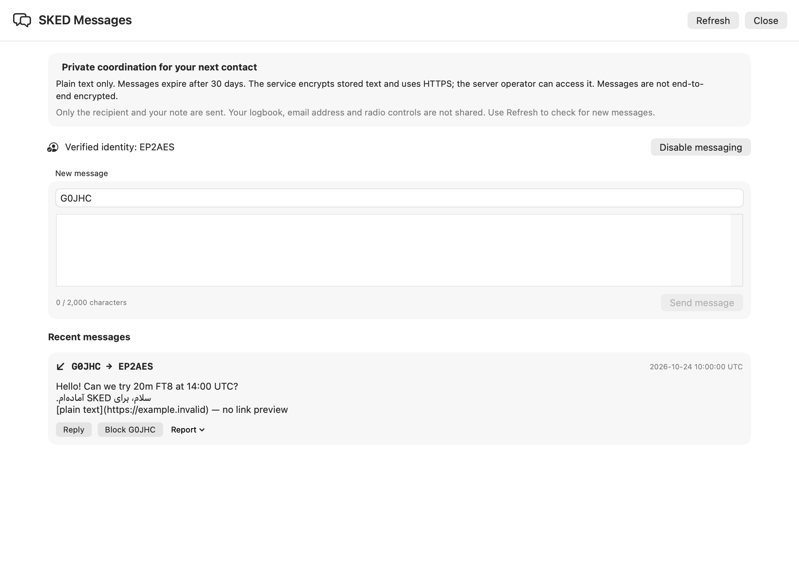

# پیام‌رسان خصوصی SKED در YAAM

بورد مشترک: [Y-164 / #422](https://github.com/fact0real/yaam-lab599-shared-board/issues/422). تاریخ: ۲۰۲۶-۱۰-۲۴، منطقهٔ زمانی تهران.

## ارزیابی و نتیجه

این قابلیت برای هماهنگی زمان، باند و مد تماس ارزش پیاده‌سازی دارد، خصوصاً وقتی اپراتور ایمیل عمومی ندارد. نسخهٔ نخست به پیام خصوصی متنی بین حساب‌های دارای هویت تأییدشده محدود شده است. در سورس محلی YAAM و qrz-rank پیاده‌سازی شد و بررسی‌های زیر را گذراند. در مرحلهٔ بعد، با درخواست صریح مالک، سرویس روی سرور اصلی فعال و YAAM **1.37.48 (198)** در Applications نصب شد. جزئیات تحویل نهایی در انتهای گزارش آمده است.

## مسیر استفاده

در صفحهٔ SKED، **Messages** صندوق پیام را باز می‌کند. آیکون پیام کنار اپراتور، گیرنده را آماده می‌کند. پس از تأیید مستقل کال‌ساین توسط مسئول سرویس و رضایت صریح کاربر، ارسال، پاسخ، دریافت صفحه‌ای، Block/Unblock و Report در دسترس است. متن حداکثر ۲۰۰۰ نویسه دارد؛ پیام تازه با Refresh دریافت می‌شود. فرستنده از توکن و هویت سرور تعیین می‌شود و از پروفایل محلی یا متن درخواست گرفته نمی‌شود. ارسال با اقدام صریح کاربر انجام می‌شود و هیچ فرمان تنظیم رادیو یا TX ندارد.

اگر پاسخ ارسال قطع شود، همان شناسهٔ درخواست برای تکرار حفظ می‌شود. پاسخ موفق یعنی پذیرش در سرور، نه خوانده‌شدن پیام. برای تغییر پیش‌نویس نامطمئن به ارسال تازه هشدار نمایش داده می‌شود. تکرار پس از ۲۴ ساعت در پنجرهٔ باز رد می‌شود؛ سرور شناسه را تا پایان نگهداری ۳۰روزه حفظ می‌کند. پیام و پیش‌نویس در حافظهٔ YAAM هستند و با بستن پنجره یا تغییر اعتبارنامه پاک می‌شوند؛ هیچ آرشیو محلی ساخته نشده است.

## تصمیم‌های امنیتی

- فعال‌سازی پیش‌فرض سرور خاموش است. عضویت اختیاری و هویت هر حساب جداگانه و مستقل تأیید می‌شود. نام کاربری، کال‌ساین پروفایل و QSO آپلودشده مدرک مالکیت نیستند. اتصال حساب به کال‌ساین یکتا و تغییرناپذیر است؛ احراز مجدد هم عضویت را خودکار فعال نمی‌کند.
- درخواست‌ها فقط با توکن شخصی و HTTPS پذیرفته می‌شوند. کوکی و توکن مرورگر مجوز پیام‌رسان نیست. کلاینت تغییرمسیر، کوکی، کش دیسک و پاسخ بیش از ۵۱۲ کیلوبایت را رد می‌کند. توکن از CredentialVault خوانده می‌شود و وارد گزارش یا UserDefaults نمی‌شود.
- هر خواندن محدود به حساب فرستنده یا گیرنده است؛ فقط گیرنده می‌تواند پیام دریافتی را گزارش کند. سرور فیلد اضافهٔ sender را نمی‌پذیرد. نبود گیرنده، مسدودشدن، عدم عضویت و عدم دسترسی گیرنده پاسخ عمومی یکسان دارند.
- متن با AES-256-GCM و nonce تصادفی رمزگذاری می‌شود؛ دادهٔ همراه، شناسهٔ طرفین و درخواست را به متن متصل می‌کند. **رمزگذاری سرتاسری نیست**؛ مدیر سرور با دسترسی به کلید قادر به خواندن متن است. این محدودیت در پنجره و راهنما توضیح داده شده است. اطلاعات مسیر پیام و زمان‌ها رمزگذاری نشده‌اند.
- محدودیت پایدار چندپردازه: ۶۰ درخواست احرازهویت‌شده در دقیقه، ۱۰ ارسال تازه در دقیقه و ۱۰۰ ارسال در روز UTC. درخواست نامعتبر و گیرندهٔ ناموجود هم سهمیهٔ عمومی را مصرف می‌کنند. سهمیهٔ پیام مستقل از رتبه‌بندی و برای حساب نامحدود هم برقرار است. محدودسازی IP در لبهٔ سرور هنوز الزام استقرار است.
- تراکنش و قفل‌های مرتب حساب‌ها از تداخل ارسال، مسدودسازی و رضایت جلوگیری می‌کنند. درخواست تکراری با همان محتوا به همان پیام می‌رسد؛ تغییر محتوا با همان شناسه رد می‌شود. خطاهای داخلی و متن خطای خام سرور در رابط نمایش داده نمی‌شوند.
- فقط متن ساده نمایش داده می‌شود؛ HTML، Markdown اجرایی، پیش‌نمایش لینک و پیوست وجود ندارد. نویسه‌های کنترلی و دست‌کاری جهت متن رد می‌شوند. لاگ‌بوک، ایمیل و اطلاعات رادیو به API پیام‌رسان فرستاده نمی‌شوند.
- پیام پس از ۳۰ روز از خواندن خارج می‌شود؛ worker مستقل هر ساعت متن و گزارش منقضی‌شده و شمارندهٔ قدیمی را در دسته‌های محدود پاک می‌کند. پاک‌سازی نسخه‌های پشتیبان و پایش سلامت worker باید در محیط استقرار تنظیم شود. غیرفعال‌کردن عضویت به معنی حذف فوری پیام‌های قبلی نیست.

این انتخاب‌ها با [راهنمای کنترل دسترسی OWASP](https://cheatsheetseries.owasp.org/cheatsheets/Authorization_Cheat_Sheet.html)، [محدودیت منابع Flask](https://flask.palletsprojects.com/en/stable/web-security/) و [مستند رمزگذاری AEAD](https://cryptography.io/en/latest/hazmat/primitives/aead/) تطبیق داده شدند. این بررسی و آزمون‌ها گواهی امنیت کامل یا ممیزی مستقل نیستند.

## فایل‌های این تغییر

YAAM: `SKEDMessagingService.swift`، `SKEDMessagingModel.swift` و `SKEDMessagingView.swift` زیر `YAAM/`؛ اتصال در `SKEDDirectoryView.swift`؛ راهنمای فارسی و انگلیسی؛ `Tests/SKEDMessagingRegression.swift` و `Tests/SKEDMessagingVisualReview.swift`.

سورس محلی سرور در `/Users/factoreal/Downloads/rank_qrz/results/qrz-project` است. فایل‌های تازه: `services/messaging.py`، `blueprints/api_messaging.py`، `messaging_admin.py`، `messaging_retention_worker.py`، `tests/test_messaging_mysql.py` و `MESSAGING.md`. ثبت blueprint در `app.py`، تنظیمات خاموش پیش‌فرض و سرویس پاک‌سازی در `docker-compose.yml` و وابستگی رمزگذاری/حداقل Flask در `requirements.txt` افزوده شدند. تغییرات قبلی هر دو مخزن حفظ شده‌اند؛ کد این قابلیت در تغییر جداگانه‌ای از کارهای ناتمام دیگر برای ارسال به مخزن آماده شد؛ نسخهٔ محلی نصب‌شده 1.37.48 (198) است. انتشار عمومی فایل نصب یا تغییر فید به‌روزرسانی انجام نشده است.

## شواهد بررسی

| بررسی | نتیجه و حد اعتبار |
|---|---|
| آزمون سرور روی پایگاه دادهٔ جدا | ۱۲ آزمون موفق روی MySQL 26.10 واقعی با InnoDB و socket محلی، نام پایگاه تصادفی و حذف پایگاه آزمون در پایان؛ هیچ حساب یا دادهٔ تولیدی استفاده نشد. |
| سناریوهای مخرب و هم‌زمانی | صندوق نامرتبط، گزارش غیرمجاز، جعل sender، ورودی بزرگ/کنترلی، توکن لغوشده، اشتراک غیرفعال، Cookie/CSRF، کلید نامعتبر، انقضا، صفحه‌بندی، رمزمتن دست‌کاری‌شده، ارسال هم‌زمان با یک UUID، مسابقهٔ Block/Send، سقف روزانهٔ حساب نامحدود و عدم واگذاری هویت بررسی شدند. |
| پاسخ یونیکد | صفحهٔ کامل ۵۰ پیام با ۲۰۰۰ ایموجی در هر پیام زیر سقف پاسخ کلاینت باقی ماند. |
| امنیت عمومی API سرور | هر ۵ آزمون موجود `test_api_security.py` موفق؛ مسیر تازه هم در بررسی احرازهویت تمام مسیرهای ثبت‌شده قرار گرفت. |
| آزمون کلاینت | موفق: ساخت درخواست محدود به مبدأ، ورودی مخرب، پاسخ حجیم، صندوق نامرتبط، خطای سهمیه، حفظ UUID پس از قطع ارتباط، پاک‌شدن داده با تغییر حساب و بستن پنجره. از شبکه یا توکن واقعی استفاده نشد. |
| رابط بومی | ۲۴ تصویر ساختگی در شش حالت loading/unavailable/unverified/disabled/inbox/retry، روشن و تیره، اندازه‌های ۷۶۰×۵۰۰ و ۱۱۰۰×۸۰۰ تولید و بازبینی شد. محتوای پایین پنجرهٔ فشرده با اسکرول قابل دسترسی است. منوها، hover و کلیک‌های انتهابه‌انتهای برنامهٔ نصب‌شده در این بازبینی بررسی نشدند. |
| ساخت برنامه | Debug با `xcodebuild`، scheme `YAAM` و امضای غیرفعال موفق شد؛ هشدار actor isolation افزوده‌شده در بازبینی اصلاح شد. |

فرمان‌های بازتولید آزمون Swift در ابتدای فایل‌های آزمون و فرمان‌های سرور در `MESSAGING.md` هستند. Docker این محیط اجرا نبود؛ آزمون DB محلی روی MySQL انجام شد. Python 3.15 میزبان با import فعلی connector سازگار نبود؛ اجرا با Python 3.13، همان ماژول‌های pure-Python اتصال و cryptography 46.0.3 انجام شد، بدون دست‌کاری کد وابستگی تولیدی. در مرحلهٔ استقرار، همان ۱۲ آزمون روی تصویر واقعی Python 3.11/MariaDB 10.11 هم موفق شدند.

## مراحل باقی‌مانده برای فعال‌سازی واقعی

راهنمای کامل در [MESSAGING.md سرور](/Users/factoreal/Downloads/rank_qrz/results/qrz-project/MESSAGING.md) نوشته شده است. کار باقی‌مانده: استقرار آزمایشی، migration جداول، حساب DB با حداقل دسترسی، تنظیم امن کلید و پشتیبان، TLS و محدودسازی لبه، پایش پاک‌سازی، تعیین مسئول گزارش سوءاستفاده، و تأیید مستقل دو حساب آزمایشی. سپس باید ارسال و دریافت واقعی YAAM در محیط آزمایشی با سه حساب و قطع ارتباط/لغو توکن/Block بررسی شود. هیچ هویتی از روی نام کاربری یا لاگ خودکار تأیید نشده و هیچ پیام واقعی برای دیگران فرستاده نشده است.

وضعیت مناسب بورد: **Review / Test** برای پیاده‌سازی محلی؛ استقرار و فعال‌سازی عمومی هنوز انجام نشده‌اند.

## تحویل نهایی با مجوز مالک

- سرویس پیام‌رسان روی همان qrz-rank فعال شد. نسخهٔ وب و worker پاک‌سازی سالم‌اند؛ بخش‌های رتبه‌بندی، تاریخچه و enrichment حفظ شدند. هیچ حساب واقعی خودکار تأیید یا عضو نشده است؛ تأیید مستقل کال‌ساین همچنان لازم است.
- بررسی واقعی دامنه با حساب موقت، HTTPS، پاسخ وضعیت، الزام هویت، رد بدون توکن، رد HTTP مستقیم، مقابله با جعل هدر پراکسی، no-store و سالم‌ماندن سایت و فهرست کشورها را تأیید کرد. حساب موقت و شمارنده‌های آن حذف شدند؛ پیام واقعی برای دیگران فرستاده نشد.
- دسترسی DB پیام‌رسان جدا و محدود است: توان ایجاد جدول یا تغییر حساب‌های کاربران را ندارد. کلید و رمز DB روی سرور تولید شدند. فایل تنظیمات و فایل جداگانهٔ سکرت‌ها root-owned با مجوز 0600 هستند؛ سکرت به هیچ مخزنی ارسال نشد.
- برای مسیر پیام، محدودیت اندازه، زمان و نرخ در Nginx برقرار شد؛ ثبت URL پیام در Nginx و Gunicorn غیرفعال است. worker با فایل‌سیستم فقط‌خواندنی، حداقل مجوز و health check اجرا می‌شود.
- پیش از جایگزینی، از سورس/تنظیمات و پایگاه داده نسخهٔ پشتیبان سازگار با تراکنش تهیه و بررسی شد. کد سرور در commit `19011d6` مخزن خصوصی qrz-rank ارسال شد؛ تغییرات قبلی سرور کنار گذاشته نشدند.
- نسخهٔ Release **1.37.48 (198)** از مبنای ثبت‌شدهٔ YAAM، همراه با همین قابلیت و بدون تغییرات ناتمام مودم/رادیو ساخته شد. برنامهٔ قبلی پشتیبان‌گیری شد و امضای محلی، برابری مجوزها، غیرفعال‌بودن debugger entitlement و هش فایل اجرایی پس از نصب در `/Applications/YAAM.app` بررسی شد. برنامه اجرا شد و پنجرهٔ واقعی SKED Messages، پیام الزام تأیید مستقل هویت را نشان داد.
- تغییرات هر دو مخزن با **Gitleaks 8.30.1** و خروجی redacted بررسی شدند؛ نتیجه: **no leaks found**. اسکن شامل اختلاف همین تغییرات بود؛ ممیزی تمام تاریخچهٔ مخزن ادعا نمی‌شود. هیچ تصویر جدیدی از لاگ واقعی یا صندوق خصوصی وارد مخزن عمومی نشد.

نگهداری خارج از سرور برای کلید/نسخه‌های پشتیبان و مسیر ارسال هشدارهای عملیاتی، مسئولیت مسئول سرویس است. تأیید مالکیت کاربران و آزمون هماهنگی واقعی بین دو اپراتور مستقل همچنان به فرایند عضویت مربوط است؛ فعال‌شدن سرویس این مرز امنیتی را دور نمی‌زند.
